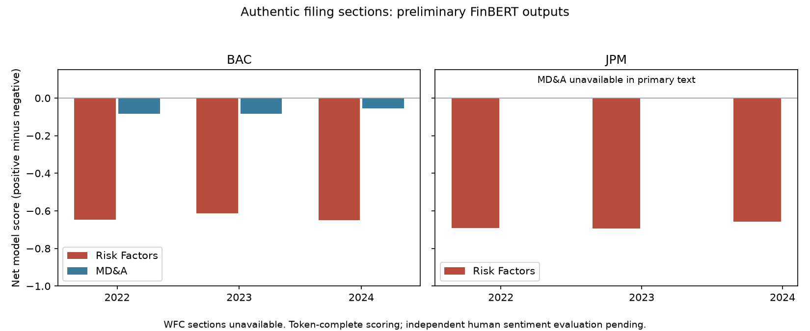

# Financial NLP: authentic sections and a separate synthetic workflow

Executed 3 November 2026. The authentic study uses real annual SEC filing text and real FinBERT inference. It remains preliminary: human sentiment evaluation is outstanding and primary-document extraction leaves material gaps. Historical synthetic examples remain explicitly synthetic.

## Bounded authentic corpus

Panel specified before scoring: JPM, BAC and WFC, annual 10-K reporting periods 2022, 2023 and 2024. Nine primary filings were downloaded using an identifying SEC header, cached locally with hashes and accession numbers, document URLs, reporting dates and acceptance timestamps. The contact address is not stored in repository artifacts. Raw caches and model weights remain ignored.

Nine of 18 requested sections are usable in the primary documents: Risk Factors for JPM and BAC, plus MD&A for BAC. JPM MD&A and both WFC sections are missing or incorporated by reference into separate annual-report material. They were neither imputed nor treated as neutral scores. Consequently paired section comparisons are limited to BAC. Expanding incorporated annual reports is a separate extraction task.

Boundary review caught inline cross-references masquerading as Item headings. The extractor now uses short block headings, and source heading/start/end inspection is recorded in `outputs/authentic/boundary-review.json`. This is bounded extraction review, not an assertion of perfect completeness. Missing-section reasons remain explicit in the full extraction export.

## Real-model execution and coverage

Model and tokenizer revision: `ProsusAI/finbert@0bc2ac10dda6929bcb1f77ccc43c7ec5c424f031`. All 327,746 content tokens across the nine sections were scored; zero tokens were truncated. Nonoverlapping chunks fit within the model's 512-token capacity including special tokens. Section probabilities are averaged by content-token count. This aggregation is pragmatic, not independently validated document sentiment. Tables, boilerplate and numerical disclosures remain in the extracted text and can affect scores.

| Bank | Reporting year | Section | Net model sentiment | Content tokens |
| --- | --- | --- | --- | --- |
| JPM | 2022 | risk_factors | -0.6919 | 22,844 |
| JPM | 2023 | risk_factors | -0.6946 | 24,273 |
| JPM | 2024 | risk_factors | -0.6574 | 25,023 |
| BAC | 2022 | risk_factors | -0.6461 | 20,712 |
| BAC | 2022 | mda | -0.0840 | 64,919 |
| BAC | 2023 | risk_factors | -0.6139 | 20,934 |
| BAC | 2023 | mda | -0.0833 | 64,933 |
| BAC | 2024 | risk_factors | -0.6492 | 21,137 |
| BAC | 2024 | mda | -0.0540 | 62,971 |

Within the three paired BAC filings, MD&A has a less negative model score than Risk Factors. This is a descriptive output of one fixed model and extraction/aggregation convention. It does not establish independently measured sentiment, unusual distress or predictive performance. JPM has no paired MD&A comparison here, and no WFC section result is available.

## Independent evaluation remains required

A frozen, blinded sample of 45 sentences is in `outputs/authentic/human_annotation.csv`. The rubric in `docs/authentic-study.md` defines positive, negative and neutral labels. Two humans label independently, then adjudicate disagreements without seeing model predictions. Run `scripts/evaluate_human_labels.py` only after labels are complete; it records the frozen label-file hash, per-class precision/recall/F1, confusion matrix and disagreement. Missing labels cause an explicit failure. No model-generated label is ground truth.

The sample is small and drawn from the same bounded corpus. It cannot establish general sentiment accuracy or a failure-warning system. Filing acceptance timestamps are preserved, but with only three annual periods per series there is no validated earlier-period threshold and later-period anomaly evaluation. No anomaly alert or bank-failure claim is made from this run.

## Reproduction

On Python 3.14 create `.venv` and install `requirements-authentic.txt`. Set SEC_CONTACT locally to the approved real contact email, then run `.venv/Scripts/python.exe scripts/run_authentic.py`. Source requests are sequential and limited to four per second, HTTP errors stop execution, and original source bytes are hashed. The pinned revision, source hashes, source-document hashes, model-cache hashes and package versions are in `outputs/authentic/manifest.json`. Hash-verified scores may be reused only for identical filing/section text and revision. Token counts reproduce exactly; CPU softmax probabilities allow absolute tolerance 1e-6 on the recorded stack.

Run `.venv/Scripts/python.exe -m pytest tests -q -p no:cacheprovider`, then `.venv/Scripts/python.exe scripts/plot_authentic.py` and `python scripts/generate_html_report.py`. For independent evaluation, complete human_annotation.csv and run `.venv/Scripts/python.exe scripts/evaluate_human_labels.py`. Do not replace real-backend failures with mock results.

Model attribution: Dogu Araci (2019), FinBERT: Financial Sentiment Analysis with Pre-trained Language Models. [Model card and weights terms](https://huggingface.co/ProsusAI/finbert). [SEC developer access guidance](https://www.sec.gov/about/developer-resources).

## Separate historical synthetic demonstration

The original generated corpus has 252 mock-scored filing-style sections across eight bank labels. Its charts illustrate section gaps, cohort choices and retrospective anomaly mechanics. Its planted-label correlation is not FinBERT accuracy; mock entities and topics are not authentic extraction. The authentic run above performs sentiment only. It does not validate entity extraction, topic modelling or the historical synthetic anomaly thresholds. Previous synthetic outputs and notebook remain available with those limits.
