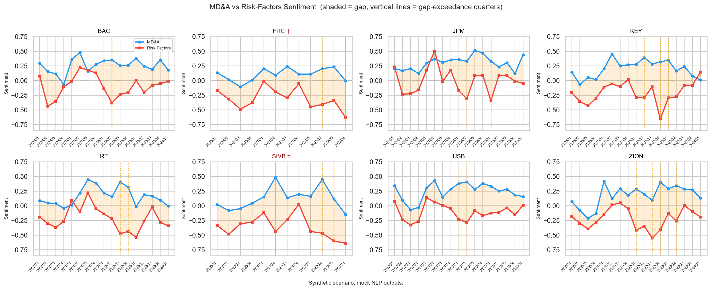
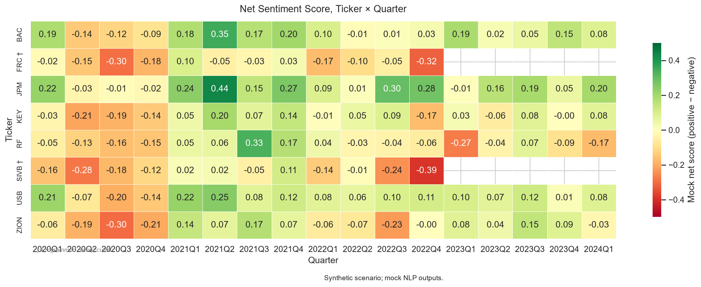
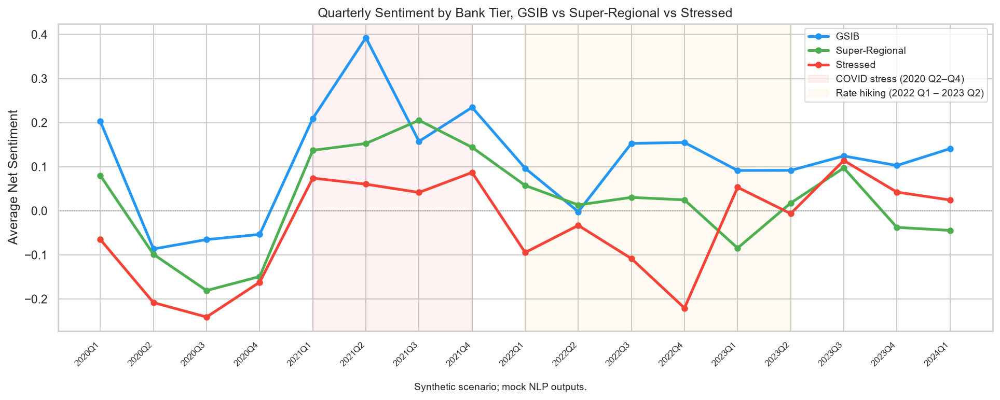
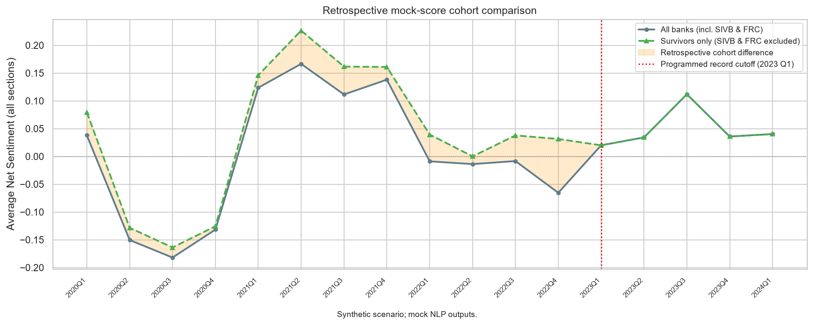

I built a workflow for comparing operating and risk language, aggregating sentiment and investigating unusual changes within an entity. The published demonstration uses synthetic filing-style text and mock NLP outputs. It illustrates the analysis machinery; it does not show that a model anticipated actual bank failures.

## What the published run contains

The saved corpus has 252 generated section records across eight bank labels and 17 calendar quarters, from 2020 Q1 to 2024 Q1. Each available ticker-quarter has one MD&A record and one Risk Factors record, giving 126 ticker-quarter observations. These are generated sections, not authentic SEC filings.

The generator assigns fixed health values, rate-regime effects and extra terminal stress to the SIVB and FRC scenarios. Both scenarios stop after 2022 Q4 under the same programmed cutoff. That cutoff simplifies history and does not establish when real filings were available.

The mock sentiment scorer reads the generator's `true_sentiment` values and adds noise. It does not infer sentiment from the text. Its saved correlation of 0.9102 with those labels confirms that the designed signal survives the mock scoring step; it does not measure FinBERT accuracy. The saved entity frequencies come from a fixed fallback table, and the seven topic labels are assigned randomly using fixed weights.

## Implemented capability and execution evidence

The project implements quarterly aggregation, MD&A/Risk Factors comparison, within-ticker anomaly calculations, tier summaries, a historical cohort comparison, charts and report exports. The executed notebook and saved summary record the synthetic and mock path.

Optional adapters wrap FinBERT, spaCy and BERTopic. They are implemented capabilities, with no verified real-model results in the published artifacts. The EDGAR branch needs further integration: the current loader does not supply actual filing dates or extract the two sections required downstream. Changing notebook flags alone is insufficient for a verified end-to-end SEC analysis.

The [saved run summary](https://github.com/jesco-tan/nlp-earnings-intelligence/blob/94c13f16020a6e8695d232d460ec55faee99b094/outputs/run_summary.json) identifies the data as synthetic and the sentiment method as correlated mock scoring. The [executed notebook](https://github.com/jesco-tan/nlp-earnings-intelligence/blob/94c13f16020a6e8695d232d460ec55faee99b094/notebooks/nlp_walkthrough.ipynb) also records fallback entity extraction and mock topics.

## Section comparison

The section gap is the mock MD&A score minus the mock Risk Factors score. It demonstrates how to compare two document sections while retaining their separate trajectories.

Synthetic scenario; mock NLP outputs. Blue shows MD&A and red shows Risk Factors. Vertical orange lines mark quarters with gap greater than 0.60. SIVB exceeds that setting in 2021 Q2, 2022 Q2 and 2022 Q3, with a maximum of 0.9247 in 2021 Q2. These are not three consecutive quarters; the 2022 Q4 gap is 0.4886.

KEY has the largest generated gap, 0.9724 in 2022 Q4. Tier differences and divergence reflect the health and regime terms deliberately specified in the generator. This run does not establish that section divergence measures optimism bias or provides empirical warning of failure.

## Retrospective anomaly scoring

The anomaly function averages both sections within each ticker-quarter, then standardises against that ticker's entire supplied series using the sample standard deviation. A score below -1.5 is flagged. The baseline includes the point being scored and, for earlier points, later observations.

Synthetic scenario; mock NLP outputs. Colours show raw net scores centred on zero, not z-scores. At the chosen anomaly setting, SIVB flags in 2022 Q4 and FRC flags in 2020 Q3 and 2022 Q4. Their final z-scores are -1.9051 and -1.7114, respectively.

There are 11 flagged ticker-quarters: eight in the programmed COVID window, two for SIVB/FRC in 2022 Q4 and one for RF in 2023 Q1. Changing the threshold magnitude from 1.5 to 1.0 increases the flag count from 11 to 25. This is an in-sample sensitivity check, not calibration of a predictive warning system.

Synthetic scenario; mock NLP outputs. Fixed health parameters and regime effects create differences between the assigned tiers. GSIBs have a positive full-period mean but negative combined scores during 2020 Q2 to Q4. These trajectories do not measure actual bank resilience.

The programmed outcomes influence health, terminal stress and record availability. Together with full-series normalisation and artificial quarter-end dates, this rules out claims that these results demonstrate warnings available before actual failures.

## Historical cohort comparison

The survivorship function compares the average of all available records with an average that excludes the SIVB and FRC labels throughout history. The survivor-only cohort uses known outcomes, so it is explicitly retrospective.

Synthetic scenario; mock NLP outputs. Means of the 17 quarterly averages are 0.0152679 for available records and 0.0416132 for the survivor-only cohort, a difference of 0.0263453 sentiment-score units. The red marker is the programmed 2023 Q1 cutoff for both labels, not the actual failure date of both banks. From that quarter the cohorts contain the same records and their curves coincide.

This illustrates how retrospective cohort selection changes a historical benchmark. It does not estimate the effect of real bank exits on sector health. The function does not carry scores forward or produce a survivorship-adjusted benchmark, and the average gap is not a general correction to apply to later quarters.

## What this project demonstrates

The engineering contribution is a modular workflow that keeps section-level and aggregate measures available, compares assigned groups, examines threshold sensitivity and exposes cohort composition through reproducible saved artifacts. Synthetic inputs make those mechanics inspectable without requiring large model downloads.

An empirical extension would need authentic filing accessions and acceptance dates, validated section parsing, recorded real-model execution without mock fallback, and evaluation on unseen entities and periods with thresholds fixed in advance. A labelled SEC-text sample would also be needed to assess sentiment quality. Until then, the published outputs remain an engineering demonstration with planted signals.
